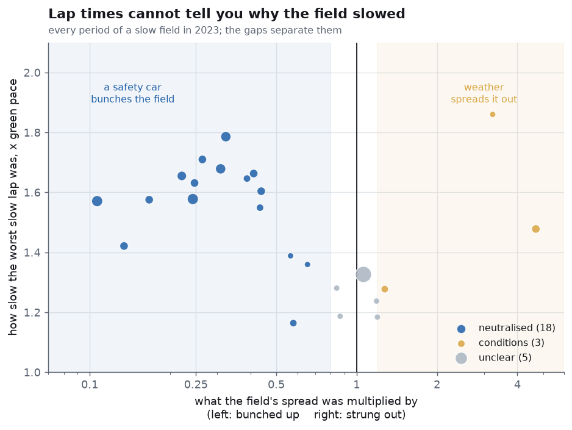
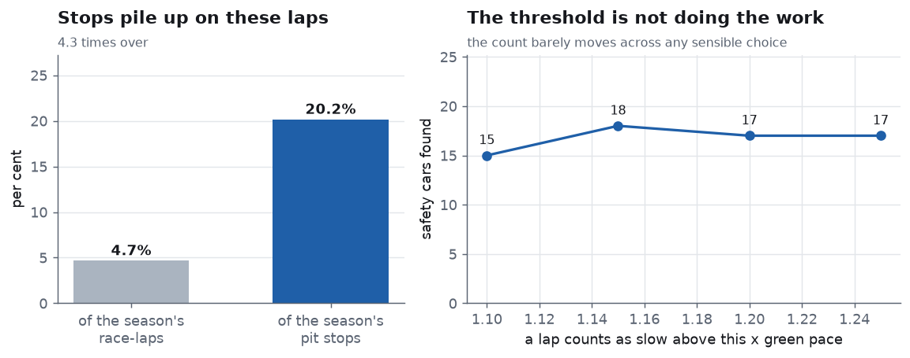
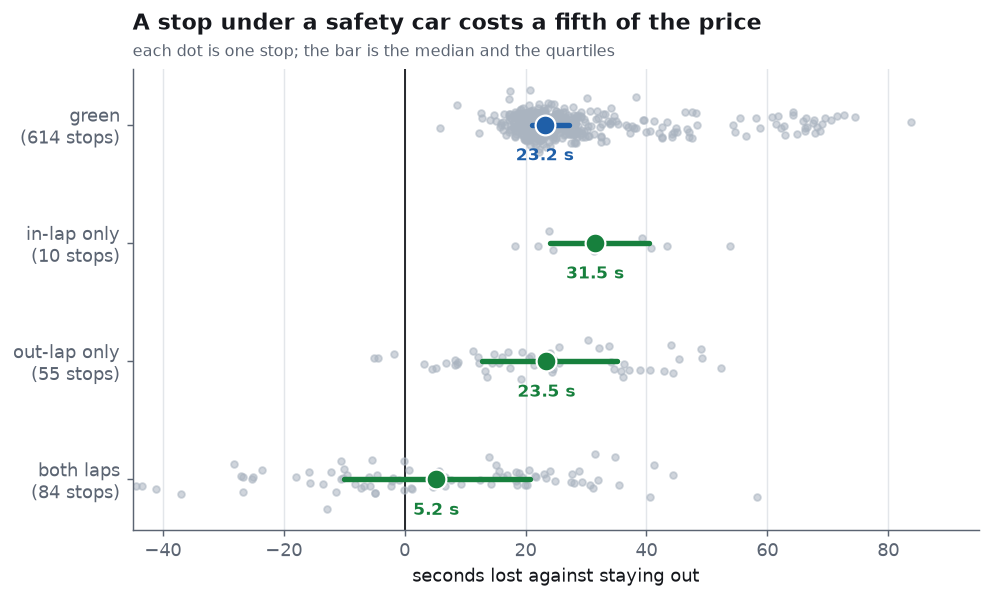
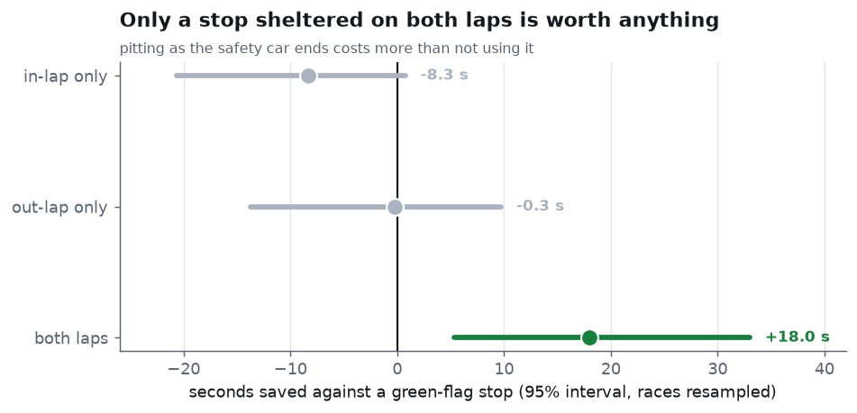
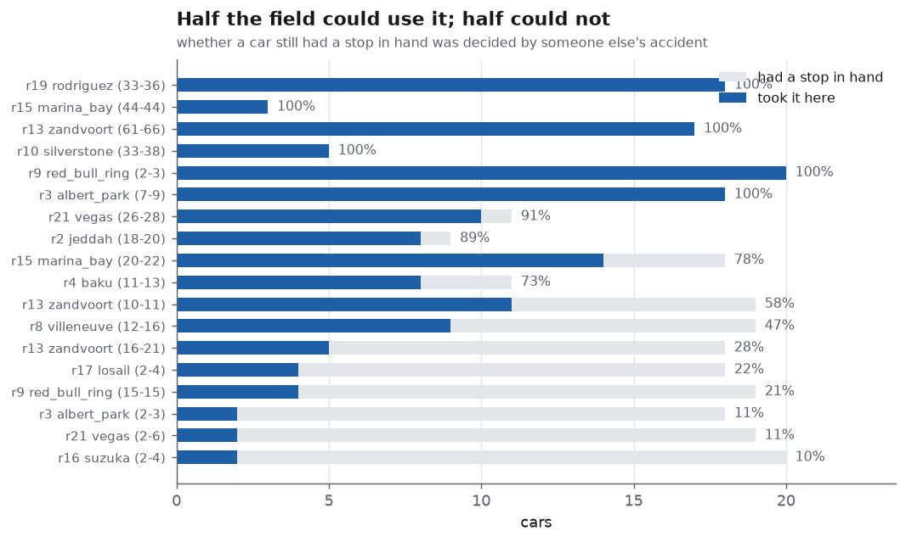
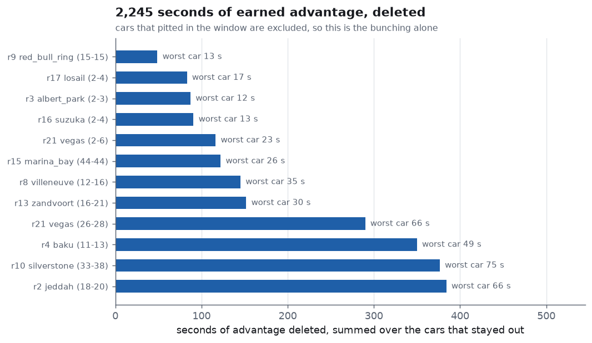

# safety-car-lottery

**What a safety car is worth, who gets to use it, and how much earned
advantage it deletes.**

A pit stop under green flags costs **23.2 seconds**. The same stop
sheltered by a safety car costs **5.2 seconds** — a prize of **18.0 s,
about 78% of a pit stop**, with a 95% interval of [+5.3, +33.0].

Nobody chooses when a safety car appears. Over the 18 neutralisations
in the 2023 season, **160 of the 280 cars that still had a stop to make
took it there**. The other 120 were already on their last set of tyres
and watched their rivals buy the same stop for a fifth of the price.
Nothing any of them did decided which group they were in.

---

## The question that comes first

The source records no safety car. It records lap times, and a safety
car is obvious in them: everybody is thirty to sixty per cent slower at
once. That part is four lines of code.

**The hard part is knowing why the field slowed.** Rain does the same
thing. So does a damp restart, or a track that is still drying. Round 6
at Monaco has a stretch of twenty laps decaying smoothly from 1.33×
green pace back to 1.08×. A detector built on lap times alone calls
that a safety car and then prices a lottery that never happened.



What separates them is not the lap times but **the gaps**. Under a
safety car the field is bunched up behind it on purpose, and the spread
of the cars collapses — in 2023, to between 0.11 and 0.57 of what it
was. Weather does the opposite, because drivers differ far more in the
wet than in the dry: Zandvoort's wet start *spread* the field by 4.69×
and Interlagos by 3.23×.

Same lap-time signature. Opposite effect on the order. One measurement
tells them apart.

| | |
|---|---:|
| races | 22 |
| race-laps | 1,303 |
| laps the field was slow | 84 |
| laps the race was stopped | 6 |
| **periods found** | **27** |
| — neutralised (a safety car) | 18 |
| — conditions (weather) | 3 |
| — unclear | 5 |
| — still running at the flag | 1 |

The five unclear periods are reported as unclear. Forcing them into one
bucket or the other would make the table tidier and the number wrong.

---

## A check that uses no lap times



A safety car makes a pit stop cheap, so if these laps really are safety
cars the stops should pile up on them. If the detector were picking up
rain, or noise, there would be no reason for stops to care.

**20.2% of the season's 912 pit stops happened on 4.7% of its
race-laps — an enrichment of 4.31×.**

The number that convinced me was not 4.31 but the move: restricting
from *all slow laps* to *laps classified as neutralised* raised it from
3.40 to 4.31. Weather does not make a pit stop cheap, so a classifier
improving an independent metric it was never fitted on is the best
evidence available that it is separating the right things.

Nothing downstream depends on this number. It is there so the detector
can be wrong in public.

The threshold is not doing the work either: between 1.10× and 1.25×
green pace, the count of safety cars moves only between 15 and 18.

---

## What a stop costs

Each stop is priced against an explicit counterfactual: what this car
would have taken on these two laps had it stayed out, which is its
race's green line for those laps, times its own pace factor, times the
slowdown in force.



| shelter | stops | median loss, s | quartiles |
|---|---:|---:|---|
| green | 614 | 23.18 | 21.09 to 27.25 |
| in-lap only | 10 | 31.49 | 24.01 to 40.39 |
| out-lap only | 55 | 23.45 | 12.73 to 35.17 |
| both laps | 84 | 5.21 | −10.07 to 20.78 |



| shelter | discount vs green | 95% interval | excludes zero |
|---|---:|---|---|
| in-lap only | −8.31 | −20.63 to +0.78 | no |
| out-lap only | −0.27 | −13.77 to +9.75 | no |
| **both laps** | **+17.97** | **+5.32 to +33.02** | **yes** |

**Only a stop sheltered on both of its laps is worth anything.** A stop
with only its in-lap sheltered costs 31.5 s — *more* than a green one.
The car dives into the pit lane behind the safety car and rejoins just
as the field is released, paying the pit lane's full price and
collecting none of the discount. It is the worst moment in the race to
stop.

**Why a difference of medians rather than a regression.** A handful of
stops carry a five-second penalty served at the stop, or a wheel that
would not go on, and they land in the right tail at sixty or a hundred
seconds. The mean green stop is about 35 s; the median is 23 s. The
mean describes the pit lane's disasters and the median describes a pit
stop. Least squares here returned +24 ± 15 — an interval wide enough to
contain the answer and its opposite.

The interval comes from resampling **whole races**, because the stops
in one race share one safety car, one pit lane and one afternoon.
Resampling stops individually treats twenty cars queuing behind the
same safety car as twenty independent facts and gives an interval
several times too narrow. There is a test for that.

---

## Who was in a position to use it



Whether a car could use a neutralisation depended on whether it still
had a stop to make. At Silverstone and Mexico City every car with a
stop in hand took it; at Suzuka's opening-lap safety car, two of
twenty did, because on lap 2 almost nobody wants new tyres yet.

---

## And what the bunching deleted

Separately from the pit-stop prize, a safety car deletes the gaps
themselves. A leader who spent thirty laps building a lead has it taken
away in one.



Measured only on cars that did **not** pit anywhere in the window, so
this is the bunching alone and not the stops. **2,245 seconds of earned
advantage deleted across the season.** At Las Vegas the leader's 11.4 s
became 0.6 s in three laps; at Silverstone, 9.7 s became 2.1 s.

---

## What this does not do

- **It does not know where the safety cars were.** It infers them. The
  three-way split leaves five periods unclear rather than forcing them.
- **It cannot separate a full safety car from a virtual one.** They
  have different slowdowns and different prizes, and lap times alone
  do not reliably distinguish a VSC from a brief full deployment.
- **It prices a stop against staying out, not against the field.** The
  positions actually gained depend on who else stopped and where they
  rejoined, which is a different calculation.
- **A car's pace factor is carried through the safety car.** Under a
  real safety car the cars are queued and running nearly identical lap
  times, so a quick car's advantage does not really persist. This will
  slightly misprice stops at the extremes of the grid.
- **One season.** Eighteen neutralisations is why the interval on the
  prize runs from +5 to +33 rather than somewhere tight.

---

## What I got wrong

**The field median was contaminated by the pit lane.** The first
version priced a stop against the median lap time of everyone. Under a
safety car half the grid dives into the pits at once, so that "field"
was itself half pit laps, looked twenty seconds slower than it was, and
made a stop appear to cost nothing — or to gain time. The fix was to
measure against the cars that stayed out.

**Then a silent default turned one safety car into an 85-second loss.**
Measuring against the cars that stayed out only works if some did. In
round 9 the entire field pitted on lap 2, so there was nobody left on
track, and the slowdown multiplier fell through to a default of 1.0 —
green pace. The whole safety car was then charged to the stop: 19 cars,
all with normal pit-lane times of 16 to 18 seconds, each apparently
losing 85 seconds. It dragged the season-wide discount from a clear
result to [−51.8, +29.8], an interval containing everything. The fix is
to refuse: no cars on track means no measurement, and 21 stops are now
declined and counted rather than guessed. There is a test named after
the bug.

**The slowdown carried the pace of whoever stayed out.** The multiplier
was the median ratio of the cars still circulating — but the cars that
stay out under a safety car are not a random half of the grid. A test
with only the slowest car staying out understated every sheltered stop
by 2.2 seconds. Each car's own pace factor is now divided back out
before the median is taken.

**Two smaller ones.** A red-flag lap bridged inside a safety-car period
was reported as the period's "worst lap" at 30× green pace, which
describes a parked car rather than a slow one. And the count of who
took a discounted stop was read off the *priced* stops, so the round
where every car pitted at once — and none of whose stops could be
priced — was reported as nineteen cars declining a free stop they had
all just taken. Whether a car pitted is a fact that needs no model.

---

## Running it

```bash
pip install -r requirements.txt
python run.py
```

The 2023 season is cached in `data/season_2023.json`, so it runs
offline and a second run costs nothing. Output goes to `out/`: six PNGs
and a printable `report.pdf`.

```bash
python -m pytest tests -q
```

34 tests. They check algebra with one right answer (bridging a gap of
one lap merges two runs, the leader's lead is the second-smallest gap),
recovery of planted truths from synthetic races with a known safety
car and a known pit loss, and that every measurement which cannot be
made is refused and counted. Three of them exist because they caught
the bugs above. No test compares against saved output.

---

## Layout

| file | what is in it |
|---|---|
| `src/data.py` | fetch and cache the season from the Jolpica/Ergast API |
| `src/gaps.py` | cumulative lap times, which is where gaps come from |
| `src/neutral.py` | finding slow periods and working out what caused them |
| `src/lottery.py` | pricing a stop, who took one, and what was deleted |
| `src/charts.py` | the six figures |
| `src/report.py` | the printable PDF report |
| `src/paper.py` | page composition: A4 pages, tables, figure bands |
| `run.py` | the pipeline, start to finish |

---

## Fachbegriffe

| English | Deutsch |
|---|---|
| safety car | Sicherheitsfahrzeug |
| virtual safety car | virtuelles Sicherheitsfahrzeug |
| neutralisation | Neutralisierung |
| red flag / race stoppage | rote Flagge / Rennunterbrechung |
| pit stop | Boxenstopp |
| pit lane | Boxengasse |
| in-lap / out-lap | Einfahrrunde / Ausfahrrunde |
| time lost in the pits | Boxenstoppverlust |
| counterfactual | kontrafaktischer Vergleich |
| field spread | Feldstreuung |
| interquartile range | Interquartilsabstand |
| median | Median |
| bootstrap | Bootstrap-Verfahren |
| cluster-robust standard error | clusterrobuster Standardfehler |
| confidence interval | Konfidenzintervall |
| sensitivity analysis | Sensitivitätsanalyse |
| threshold | Schwellenwert |
| enrichment | Anreicherung |
| fuel load | Kraftstoffmenge |
| tyre degradation | Reifenabbau |
| lap time | Rundenzeit |
| selection effect | Selektionseffekt |

---

## Data

Lap times, pit stops and results from the [Jolpica](https://api.jolpi.ca)
mirror of the Ergast schema, 2023 season: 24,386 lap times and 912 pit
stops over 22 rounds. The cleaning rules are carried over from
[stint-degradation](https://github.com/Pratsss24/stint-degradation),
[undercut-effect](https://github.com/Pratsss24/undercut-effect),
[pace-to-pass](https://github.com/Pratsss24/pace-to-pass) and
driver-or-car.
